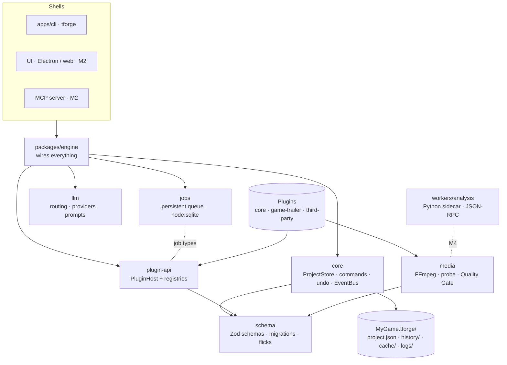

# TrailerForge

Local-first studio for game trailers and marketing videos: **brief → storyboard → capture guide → auto-cut → review → export**. You supply real gameplay footage and voice; TrailerForge does the structuring and the tedious cutting.

> **Status:** Milestone 1 (foundations) complete: schemas, project store, job queue, plugin system, FFmpeg wrapper, LLM adapter, engine and CLI. No UI yet (M2). See [docs/PLAN.md](docs/PLAN.md) for the full plan.

## Setup

Requirements: **Node 22+**, **pnpm 10**, **FFmpeg + ffprobe** on `PATH` (or set `TFORGE_FFMPEG_DIR`), and **Python 3.11+ with [uv](https://docs.astral.sh/uv/)** for the analysis sidecar.

```bash
pnpm install
pnpm build
pnpm check          # typecheck, lint, format, TS tests, Python tests
```

Try the CLI:

```bash
node apps/cli/dist/bin.js new ./Ember.tforge --name "Ember Knight" --type game-trailer/release-trailer
node apps/cli/dist/bin.js info ./Ember.tforge
node apps/cli/dist/bin.js probe ./capture.mp4
node apps/cli/dist/bin.js proxy ./capture.mp4      # background job with progress, resumable
node apps/cli/dist/bin.js jobs
node apps/cli/dist/bin.js plugins
```

From a game repo to a storyboard (the LLM step uses `ANTHROPIC_API_KEY`, or falls back to your Claude Code login):

```bash
tforge knowledge scan ./Ember.tforge --repo ~/Games/EmberKnight   # read-only; secrets and ignored files are never read
tforge brief check ./Ember.tforge                                  # what the video type still needs (exit 1 if incomplete)
tforge storyboard generate ./Ember.tforge --duration 60 --assume   # --assume logs assumptions for missing fields
```

### Local engine service (for the UI)

```bash
tforge serve --allow-origin http://localhost:5173   # prints the URL and a fresh token
```

Loopback only, a new random token every launch (required on every request, including the event stream), Host and Origin checks against DNS rebinding and other web pages, JSON bodies with a size cap. Long operations (generate, regenerate, scan) run as cancellable tasks; edits to a project are refused while one runs on it.

### The UI (web mode)

```bash
pnpm --filter @trailerforge/ui build
node apps/cli/dist/bin.js serve --ui apps/ui/dist     # prints "Open the UI: http://127.0.0.1:<port>/#token=…"
```

Open that link in a browser. The Brief tab walks through what the video type needs (completeness meter, "Suggest for me" that you review before saving, "Proceed with assumptions" that lists every assumption so you can remove it). The token travels after the `#`, so it never reaches a server or log; the page reads it, removes it from the address bar, and keeps it for that tab only. For UI development run `pnpm --filter @trailerforge/ui dev` and start the service with `--allow-origin http://localhost:5173`; it prints a "Dev UI" link. Browser tests: `pnpm test:e2e` (set `TFORGE_CHROMIUM` to a Chromium executable if Playwright's own download is not installed).

The Game knowledge tab scans your repo (secrets and ignored files are never read), lists what it found with a per-entry "Exclude from AI" switch, lets you edit, add and remove entries, and offers the opt-in deep scan behind an explicit confirmation.

The Storyboard tab shows sections and slots with a length bar against the target. Edit titles and lengths in place, open a slot's details, add or delete shots, cards and sections, reorder with buttons or by dragging, lock sections so neither you nor the AI changes them, undo anything, and ask "Why?" to see the recorded reason behind each generated section.

Generating and rewriting show, before anything is sent, which AI provider will be used, whether that leaves your computer, and exactly what goes with the request (brief fields, game facts by name, and a count of the ones you excluded). Sending to another service needs a tick, remembered for that browser tab only.

#### Settings

The Settings page shows which AI providers are available and why not, takes an Anthropic API key (sent once to the local service, stored in an owner-only file under the home directory, never shown again; not encrypted, Electron will use the OS keychain), and edits which provider, model and effort each kind of request uses (saved to `llm.routes.json`, applied immediately). With the **Chat Handoff** provider, a dialog shows the request to copy into any chat and takes the reply back; an invalid reply produces a follow-up to paste into the same chat.

### Desktop app (Electron)

In the desktop app, **Browse…** buttons open the Windows file chooser to open a project, pick where a new one goes, link a game repo and add a watched folder. A web browser cannot learn where a chosen folder is, so there you type or paste the path.

`apps/desktop` runs the engine and service inside the app and opens a window on them. API keys are encrypted with the OS credential store (Electron `safeStorage`, kept in `secrets.safe.json`; when the OS offers no real encryption, including Linux's `basic_text` fallback, it uses the plain owner-only `secrets.json` and says so in Settings). The window can only show the local service (navigations and redirects elsewhere are blocked; other web links open in your browser), grants no device permissions, refuses `<webview>`, and its file pickers answer only that window. Quitting waits for the engine to save and release project locks. Run it on a desktop machine: `pnpm approve-builds` (allow `electron`), then `pnpm --filter @trailerforge/desktop start`. Packaging config is `apps/desktop/electron-builder.yml`. Not verified in the cloud container (no display); the main-process logic is tested with a fake host. The preload exposes native folder/file pickers (`window.trailerforgeDesktop`); the UI does not use them yet. Downloads (such as "Download Markdown" on the Capture tab) use Electron's own Save dialog.

### Drive a project from Claude Code (MCP)

Easiest: open **Settings → Claude Code** and press **Connect Claude Code**, then start a new Claude Code session. Claude Code then talks to the running app (MCP over HTTP at `http://127.0.0.1:47821/mcp`, its own token kept in `<home>/mcp-token`): it works on the project open in the window without being told the path, its edits appear in the window at once, and Undo covers them. Registering only touches the `trailerforge` entry in Claude Code's `~/.claude.json` (the file the `claude` command and the Claude desktop app both read), keeping a `.tforge-backup` copy. If the fixed port is taken, the app uses another and Settings says "Needs reconnecting". To use Claude Code while the app is closed, choose "Use the separate tool instead": Claude Code then starts its own copy (a project open in the app is locked for it). By hand, the separate tool is:

```bash
claude mcp add trailerforge -- node /path/to/trailerforge/apps/cli/dist/bin.js mcp ./Ember.tforge
```

Then ask Claude Code things like "show me the capture checklist", "show me the storyboard", "make the hook shot 3 seconds and add a capture note", or "regenerate the escalation section with more forest". It gets read tools (`project_summary`, `brief_get`, `knowledge_list`, `storyboard_get`, `decision_log`), `undo`/`redo`, `knowledge_scan`, `storyboard_generate`, `storyboard_regenerate_section`, the capture tools (`capture_plan`, `capture_status`, `capture_settings`, `capture_tips`, `capture_export`), and one tool per editing command (including `game-trailer_capture_set-status` and friends for ticking shots off). Every edit is validated, saved immediately and undoable, and locked sections refuse changes.

What the server deliberately will not do on its own: run the deep repo scan (it sends file contents to Anthropic, so it needs you at the CLI with `--allow-deep-scan`), or register a new game repo, unless you start it with `--repo-root <folder>` (repos under that folder are allowed). `storyboard_generate` sends the brief and non-excluded game facts to the configured LLM provider.

`knowledge scan --deep --allow-deep-scan` additionally lets Claude Code read a temporary copy of the repo's text files (no secrets, no ignored files); this sends file contents to Anthropic, so it is off unless you confirm it.

### Recording the footage (capture pack)

Once the storyboard is written, the **Capture** tab turns it into a recording checklist:

- **Grouped by where you record**: location, then setup, then the featured boss or character, so each level load and setup change happens once. Each shot says what to do, the framing, HUD on or off, and how long to record ("record 7 s" for a 2.5 s cut, so the edit has handles). Cards (title, end slate) are generated, so they are not on the list.
- **Tick shots off** as you record them, or set them to approved or "rejected, record again". Count takes, write notes, skip a shot you will not record, and reorder shots within a group (↑/↓ or drag). Everything is undoable and none of it changes the storyboard.
- **Recording settings** are worked out from the platforms in the brief, the video type, the shots' HUD needs and your output formats: resolution, frame rate, bitrate, codec, container, HUD and HDR. Change any value to override it (marked "Your override", with a reset). Warnings cover the usual ways a recording goes wrong: variable frame rate (Game Bar, GPU overlays, phone recorders), compressed console clips, 30 fps games, a capture smaller than the export.
- **Setup hints** come from your game knowledge: the level, the featured entities, and debug commands and save files. For a Unity project the scan finds console commands (`[ConsoleMethod]`, `[ConsoleCommand]`, `[Command]`, `[Cheat]`, `AddCommand(...)`) and where the game saves (`persistentDataPath` files, Easy Save, PlayerPrefs), with the Windows path. You can add your own as game facts tagged `debug-command` or `save-file` (add `all-levels` if they work everywhere).
- **Tips (optional, AI)**: a few tips and risks per group. You see which provider is used and what is sent first; your notes are never sent, and game facts you excluded are removed from the request (and the request is refused if any would slip through). Tips show "Out of date" when a group changes, and tips you edit are never replaced unless you say so.
- **Share the pack**: write `capture-pack.md` (a checklist), `capture-pack.html` (a self-contained printable page: no scripts, no network) and `capture-pack.json` (for the footage import in M4) to the project's `exports/capture/` folder, or save a copy through your browser's download (in the desktop app, its Save dialog). "Leave out anything about game facts I excluded" makes a copy safe to share.
- **Shot codes**: every shot has a short code such as `TF-K7QF2`, shown in the Capture tab and in the pack. Put it in the recording's file name (`TF-K7QF2 take2.mp4`; case and separators don't matter, OBS date stamps are fine) and the footage import (M4) matches the file to its shot.
- **AI vision for matching (opt-in)**: an optional CLIP-style model compares frames of your recordings with each shot's description, on your computer. It needs a one-time download that you agree to first, after being shown its size, source and licence (only MIT, Apache-2.0 or BSD models can be pinned); each file is checked against a pinned checksum before it is kept, and the request is logged in `<home>/logs/egress.jsonl`. After that it works offline; no footage, frames or project data are ever sent. Builds without a pinned model hide the option (maintainers: `pnpm --filter @trailerforge/analysis pin:vision` where huggingface.co is reachable).

### From recordings to a rough cut (M4)

1. **Name your recordings** with the shot code from the Capture tab or the pack (`TF-K7QF2 take2.mp4`). It is optional, but a coded file matches its shot with certainty.
2. **Add them** on the **Footage** tab: paste a folder or file path (in the desktop app, drop files or use Choose folder…). Recordings are referenced where they are, never copied, and the same recording is never added twice, whatever it is called. A recording still being written is retried for a few seconds, then reported. Small editing copies and a thumbnail are built in the background (under `<home>/library/cache/`, safe to delete).
3. **Check the warnings** each recording shows (variable frame rate, HDR, low resolution, several audio tracks...).
4. **Match recordings to shots**: coded files say "Shot code"; the rest get up to three suggestions with the reasons (recording order, length, the session they were recorded in, and AI vision once enabled). "Attach the N confident" does the sure ones in one undo step; choose the rest by hand. On the takes list, pick the take the cut uses, or reject a bad one. Optionally, `tforge rank-takes` asks the AI to choose between takes from text only.
5. **Choose the music** on the **Cut** tab (add the music file on the Footage tab first) and press **Analyse**: beats, bars and sections (librosa), and each recording's shot changes, black, flash and frozen frames (FFmpeg, PySceneDetect, OpenCV), all on this computer. Results are cached per recording in the project's `cache/analysis/` folder.
6. **Build the cut**: the storyboard is laid on the bars and beats, each shot cut a frame ahead of the beat from its best take at its cleanest, most active stretch, shots without footage stay visible as placeholders, cards go on their own track and the music fades out over the last bar. Every clip says why it was chosen.
7. **Edit**: select a clip to trim its start or end by a frame or to the next or previous beat, swap the take, empty it or delete it; lock a track to protect it. **Rebuild** keeps your edited clips and locked tracks and re-times the rest; Undo goes back. Preview plays the cut from the editing copies in time with the music, without rendering.

The same steps work from the command line: `tforge ingest <project> <files or folders> --wait`, `tforge footage <project>`, `tforge analyze <project> --wait`, `tforge match <project> [--accept]`, `tforge rank-takes <project>`, `tforge cut <project>`. Claude Code can drive steps 3–7 over MCP; it cannot add files (that stays your choice).

**What leaves your computer in M4:** nothing about your footage. Recordings, frames, file names and paths are never sent anywhere. The optional take ranking sends text only (the shot's words, your notes and measured numbers, with shots and takes as aliases and excluded game facts removed), and only after you agree when the provider is not local. The optional vision model is a one-time download you agree to; every network request is logged in `<home>/logs/egress.jsonl`. If the app is closed or crashes during analysis, the analysis process stops too.

The same from the command line:

```bash
tforge capture plan ./Ember.tforge            # the checklist (--todo for what is left)
tforge capture mark ./Ember.tforge shot_parry --status recorded --takes 2 --note "use take 2"
tforge capture settings ./Ember.tforge --set fps=30 --set resolution=2560x1440   # --unset fps, --reset
tforge capture tips ./Ember.tforge            # --group <key>, --force, --overwrite-edited
tforge capture export ./Ember.tforge --format md,html --omit-excluded
tforge capture status ./Ember.tforge --json
```

App data (job database, temp files, drop-in plugins) lives in `$TFORGE_HOME` (default `~/.trailerforge`).

## Architecture



### Packages

| Package                    | Responsibility                                                                                                                                                                                                                           |
| -------------------------- | ---------------------------------------------------------------------------------------------------------------------------------------------------------------------------------------------------------------------------------------- |
| `@trailerforge/schema`     | Zod schemas for the project file (brief, storyboard, multi-track timeline, assets, knowledge, campaign fields), JSON Schema export, migrations, `parseProject()` (schema + cross-reference checks). Timeline time is integer **flicks**. |
| `@trailerforge/core`       | `ProjectStore`: atomic crash-safe saves, lock, commands applied via Immer with validation, undo/redo, autosave, version history. Typed `EventBus`.                                                                                       |
| `@trailerforge/jobs`       | Persistent job queue: concurrency limits, priorities, retries with backoff, timeouts, cancel, checkpoints, resume after crash.                                                                                                           |
| `@trailerforge/plugin-api` | The only surface plugins import: `definePlugin`, `PluginHost`, namespaced registries, contribution interfaces.                                                                                                                           |
| `@trailerforge/media`      | FFmpeg/ffprobe wrapper: capability detection (verified hardware encoders), probing, typed `MediaError`s, filtergraph builder, proxies/thumbnails/filmstrips, loudness, Quality Gate.                                                     |
| `@trailerforge/llm`        | Provider-agnostic structured output with validate-and-repair, editable prompt files, `llm.routes.json` routing, disclosure gate. Providers: Mock, Chat Handoff, Claude Code.                                                             |
| `@trailerforge/engine`     | Composition root plus the built-in `core` plugin.                                                                                                                                                                                        |
| `apps/cli`                 | `tforge` command line.                                                                                                                                                                                                                   |
| `workers/analysis`         | Python analysis sidecar (JSON-RPC over stdio).                                                                                                                                                                                           |

### Core rules

- **`project.json` is the single source of truth.** It changes only through typed commands, which are validated, undoable and recorded in history. Nothing reaches around the store.
- **Local-first.** Footage is referenced by path and hash, never uploaded. Any request that leaves the machine passes the disclosure gate.
- **Explainable.** Automated choices are logged to `logs/decisions.jsonl` with their reasons.
- **Deterministic.** Identical inputs produce identical filtergraphs and render plans.

## Writing a plugin

A plugin is a module that default-exports `definePlugin(...)`. Every id it registers must start with `<pluginId>/`.

```ts
import { definePlugin, PLUGIN_API_VERSION } from '@trailerforge/plugin-api';

export default definePlugin({
  id: 'devlog-pack',
  name: 'Devlog pack',
  version: '0.1.0',
  apiVersion: PLUGIN_API_VERSION,
  dependsOn: ['core'],
  register(ctx) {
    ctx.videoTypes.register({
      id: 'devlog-pack/devlog-teaser',
      name: 'Devlog teaser',
      requirements: [
        { field: 'title', label: 'Game name' },
        { field: 'keySellingPoints', label: "What's new", minItems: 2 },
      ],
      typicalDuration: { min: 15, max: 45 },
    });
    ctx.on('core/render.done', (e) => ctx.log('info', `rendered ${JSON.stringify(e)}`));
  },
});
```

Things a plugin can register: video types, storyboard templates, platform profiles, export presets, transitions, effects, analysis steps, knowledge extractors, motion renderers, LLM providers, UI panels, commands and job types. A plugin loads all-or-nothing: if `register` throws, everything it registered is rolled back and only that plugin is disabled.

**Installing a plugin:** put a folder containing `package.json` (with `main`) in `$TFORGE_HOME/plugins/`. `tforge plugins` shows its status. A full authoring guide and a "how to add a new video type" tutorial come with M7.

## License

TBD. Dependencies are chosen to stay compatible with closed-source distribution; FFmpeg is used from the user's installation.
