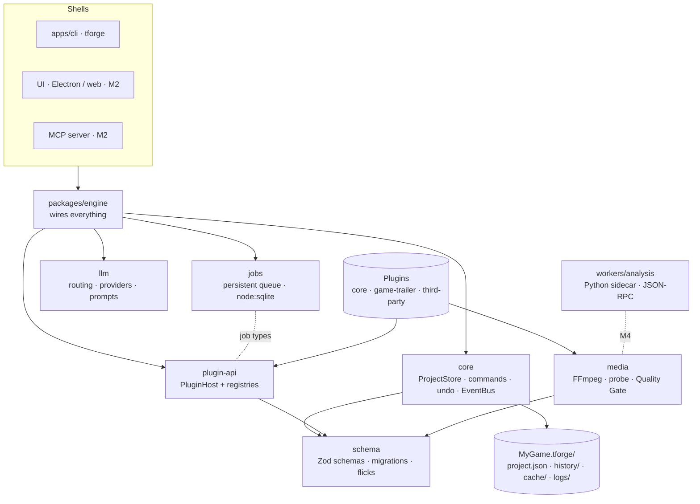

# TrailerForge

Local-first studio for game trailers and marketing videos: **brief → storyboard → capture guide → auto-cut → review → export**. You supply real gameplay footage and voice; TrailerForge does the structuring and the tedious cutting.

> **Status:** Milestone 1 (foundations) complete: schemas, project store, job queue, plugin system, FFmpeg wrapper, LLM adapter, engine and CLI. No UI yet (M2). See [docs/PLAN.md](docs/PLAN.md) for the full plan.

## Setup

Requirements: **Node 22+**, **pnpm 10**, **FFmpeg + ffprobe** on `PATH` (or set `TFORGE_FFMPEG_DIR`), and **Python 3.11+ with [uv](https://docs.astral.sh/uv/)** for the analysis sidecar.

```bash
pnpm install
pnpm build
pnpm check          # typecheck, lint, format, TS tests, Python tests
```

Try the CLI:

```bash
node apps/cli/dist/bin.js new ./Ember.tforge --name "Ember Knight" --type game-trailer/release-trailer
node apps/cli/dist/bin.js info ./Ember.tforge
node apps/cli/dist/bin.js probe ./capture.mp4
node apps/cli/dist/bin.js proxy ./capture.mp4      # background job with progress, resumable
node apps/cli/dist/bin.js jobs
node apps/cli/dist/bin.js plugins
```

From a game repo to a storyboard (the LLM step uses `ANTHROPIC_API_KEY`, or falls back to your Claude Code login):

```bash
tforge knowledge scan ./Ember.tforge --repo ~/Games/EmberKnight   # read-only; secrets and ignored files are never read
tforge brief check ./Ember.tforge                                  # what the video type still needs (exit 1 if incomplete)
tforge storyboard generate ./Ember.tforge --duration 60 --assume   # --assume logs assumptions for missing fields
```

`knowledge scan --deep --allow-deep-scan` additionally lets Claude Code read a temporary copy of the repo's text files (no secrets, no ignored files); this sends file contents to Anthropic, so it is off unless you confirm it.

App data (job database, temp files, drop-in plugins) lives in `$TFORGE_HOME` (default `~/.trailerforge`).

## Architecture



### Packages

| Package                    | Responsibility                                                                                                                                                                                                                           |
| -------------------------- | ---------------------------------------------------------------------------------------------------------------------------------------------------------------------------------------------------------------------------------------- |
| `@trailerforge/schema`     | Zod schemas for the project file (brief, storyboard, multi-track timeline, assets, knowledge, campaign fields), JSON Schema export, migrations, `parseProject()` (schema + cross-reference checks). Timeline time is integer **flicks**. |
| `@trailerforge/core`       | `ProjectStore`: atomic crash-safe saves, lock, commands applied via Immer with validation, undo/redo, autosave, version history. Typed `EventBus`.                                                                                       |
| `@trailerforge/jobs`       | Persistent job queue: concurrency limits, priorities, retries with backoff, timeouts, cancel, checkpoints, resume after crash.                                                                                                           |
| `@trailerforge/plugin-api` | The only surface plugins import: `definePlugin`, `PluginHost`, namespaced registries, contribution interfaces.                                                                                                                           |
| `@trailerforge/media`      | FFmpeg/ffprobe wrapper: capability detection (verified hardware encoders), probing, typed `MediaError`s, filtergraph builder, proxies/thumbnails/filmstrips, loudness, Quality Gate.                                                     |
| `@trailerforge/llm`        | Provider-agnostic structured output with validate-and-repair, editable prompt files, `llm.routes.json` routing, disclosure gate. Providers: Mock, Chat Handoff, Claude Code.                                                             |
| `@trailerforge/engine`     | Composition root plus the built-in `core` plugin.                                                                                                                                                                                        |
| `apps/cli`                 | `tforge` command line.                                                                                                                                                                                                                   |
| `workers/analysis`         | Python analysis sidecar (JSON-RPC over stdio).                                                                                                                                                                                           |

### Core rules

- **`project.json` is the single source of truth.** It changes only through typed commands, which are validated, undoable and recorded in history. Nothing reaches around the store.
- **Local-first.** Footage is referenced by path and hash, never uploaded. Any request that leaves the machine passes the disclosure gate.
- **Explainable.** Automated choices are logged to `logs/decisions.jsonl` with their reasons.
- **Deterministic.** Identical inputs produce identical filtergraphs and render plans.

## Writing a plugin

A plugin is a module that default-exports `definePlugin(...)`. Every id it registers must start with `<pluginId>/`.

```ts
import { definePlugin, PLUGIN_API_VERSION } from '@trailerforge/plugin-api';

export default definePlugin({
  id: 'devlog-pack',
  name: 'Devlog pack',
  version: '0.1.0',
  apiVersion: PLUGIN_API_VERSION,
  dependsOn: ['core'],
  register(ctx) {
    ctx.videoTypes.register({
      id: 'devlog-pack/devlog-teaser',
      name: 'Devlog teaser',
      requirements: [
        { field: 'title', label: 'Game name' },
        { field: 'keySellingPoints', label: "What's new", minItems: 2 },
      ],
      typicalDuration: { min: 15, max: 45 },
    });
    ctx.on('core/render.done', (e) => ctx.log('info', `rendered ${JSON.stringify(e)}`));
  },
});
```

Things a plugin can register: video types, storyboard templates, platform profiles, export presets, transitions, effects, analysis steps, knowledge extractors, motion renderers, LLM providers, UI panels, commands and job types. A plugin loads all-or-nothing: if `register` throws, everything it registered is rolled back and only that plugin is disabled.

**Installing a plugin:** put a folder containing `package.json` (with `main`) in `$TFORGE_HOME/plugins/`. `tforge plugins` shows its status. A full authoring guide and a "how to add a new video type" tutorial come with M7.

## License

TBD. Dependencies are chosen to stay compatible with closed-source distribution; FFmpeg is used from the user's installation.
